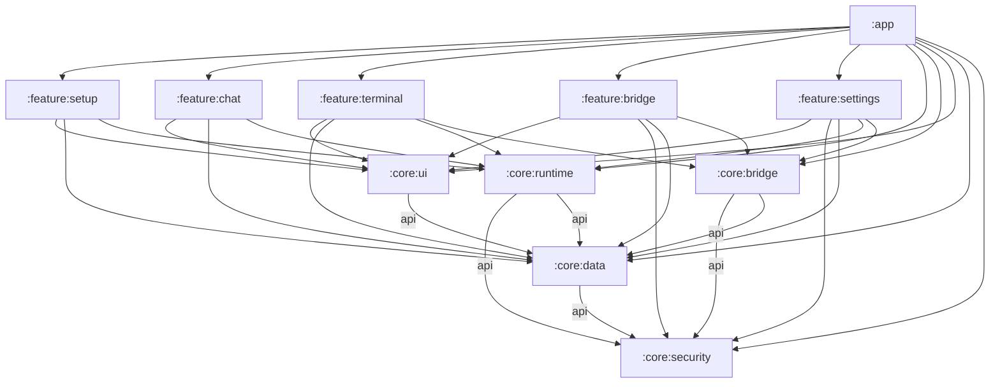

# DSHN 模块化拆分说明

> 适用分支：`aistudio-refactor` @ `47b6a01`（2026-11-24，提交署名 Codex，注明“synced from AI Studio 1684851”）
> 对比基线：`main` @ `4531f89`
> 本文写于 2026-11-24，第 7 节是同日的代码审查结论。

## 1. 为什么拆、拆成了什么

拆分前，除资源外几乎所有代码都在 `:app` 一个模块里。界面状态和业务逻辑集中在一个约 2250 行的 `MainViewModel`，`ChatScreen` 和 `SettingsScreen` 也各有 1000–1700 行。拆分后共 11 个 Gradle 模块：

- 1 个 `:app`，只负责启动、组装和导航；
- 5 个 `core:*`，放无界面的基础能力；
- 5 个 `feature:*`，每个功能页一个模块。

改动规模：108 个文件，+8228 / −5817 行。

| 模块 | 职责 | 主要内容 | 源码 | 单测 |
|---|---|---|---|---|
| `:app` | 入口、依赖组装、导航 | `DshnApplication`、`MainActivity`、`AppViewModel`、`di/AppContainer`、`navigation/DshnNavHost`；manifest、`assets/`、`jniLibs/`、图标资源 | 5 个 / 512 行 | 2 |
| `:core:security` | 安全策略与加密 | `AdbArgvPolicy`、`RootCommandPolicy`、`AuditLogger`、`KeystoreCrypto` | 4 / 812 | 6 |
| `:core:data` | 设置与全局消息 | `SettingsStore`（含 `resolveIsZhLocale`）、`StatusBannerBus`、`ClipboardHelper` | 3 / 268 | 5 |
| `:core:bridge` | 设备桥与 Root | `DeviceBridgeMcpServer`、`ConfirmationBroker`、`DshnAccessibilityService`、`RootAuthManager`、`HostRootShellSession`、`WirelessAdbClient` | 6 / 2211 | 8 |
| `:core:runtime` | 容器、ACP、会话 | AIDL 接口、`AcpClient`、`SurfaceHistoryFold`、`ContainerLauncher`、`EnvManager`、`TarGzExtractor`、`RuntimeService`/`RuntimeSupervisor`/`RuntimeController`、`SessionBridgeClient`、`TerminalPtySession`，以及新增的 `RuntimeSessionCoordinator`、`EnvironmentCoordinator`、`ChatModels` | 16 / 5686 | 12 |
| `:core:ui` | 共享界面组件 | `DshnTheme`、`AppStrings`（`tr()`）、`MarkdownText`、`UiComponents`、`SystemHelpers`、`SetupSharedComponents` | 6 / 1962 | 0 |
| `:feature:setup` | 首启向导 | `SetupScreen`、`SetupViewModel`、`SetupPolicy`（`shouldRequireInitialSetup`）、`SetupNavigation` | 4 / 822 | 1 |
| `:feature:chat` | 对话主页 | `ChatScreen`、`ChatMessages`、`ChatComposer`、`ChatDialogs`（审批/提问弹窗）、`SessionDrawer`、`ChatViewModel`、`ChatNavigation` | 7 / 2252 | 0 |
| `:feature:terminal` | 终端 | `TerminalScreen`、`AnsiTerminalBuffer`、`TerminalViewModel`、`TerminalNavigation` | 4 / 677 | 2 |
| `:feature:bridge` | 设备桥与 Root 页、调试台 | `DeviceBridgeScreen`、`DeviceLabScreen`/`DeviceLabCards`、`DeviceBridgeConfirmDialog`、`DeviceBridgeViewModel`、`HostPortParser` | 7 / 2110 | 1 |
| `:feature:settings` | 分组设置 | 首页、模型、权限、后台、运行环境、日志诊断、关于共 7 个页面，以及 `SettingsViewModel`、`EnvironmentDiagnosticsViewModel`、`SettingsNavigation` | 10 / 1781 | 0 |

单测共 37 个，拆分前是 34 个。

## 2. 依赖关系



约定：

- feature 模块之间**互不依赖**。跨页面跳转全部由 `:app` 的 `DshnNavHost` 通过回调（`onOpenTerminal`、`onOpenSettings` 等）完成。
- core 模块不依赖任何 feature 模块，也不依赖 `:app`。原来 `RuntimeService` 和 `ConfirmationBroker` 在通知里直接引用 `MainActivity::class`，现在改成 `packageManager.getLaunchIntentForPackage(...)`，以免反向依赖。
- `:core:ui` 用 `api` 暴露 Compose BOM、Material3、图标和 lifecycle-compose，feature 模块无需重复声明这些依赖。
- `:core:runtime` 和 `:core:bridge` 之间没有依赖。`HostRootShellSession` 从 `runtime` 包移到了 `bridge` 包，因为它只依赖 `RootAuthManager`。

所有模块统一使用 `compileSdk 36`、`minSdk 30`、AGP 8.9.2、Kotlin 2.0.21，插件版本在根 `build.gradle.kts` 里声明。项目目前没有 version catalog，三方库版本在各模块里分别写死（例如 navigation-compose 2.8.5、activity-compose 1.9.3）。

## 3. 包名与 namespace

| | Gradle `namespace` | Kotlin 包名 |
|---|---|---|
| core:security / data / bridge / runtime | `dev.dshn.core.*` | **保留 `dev.dshn.app.*`**（如 `dev.dshn.app.runtime`） |
| core:ui | `dev.dshn.core.ui` | `dev.dshn.core.ui`（已改名） |
| feature:* | `dev.dshn.feature.*` | `dev.dshn.feature.*` |
| app | `dev.dshn.app` | `dev.dshn.app` |

core 模块保留旧包名，有三个原因：

1. manifest 里用相对类名注册了 `.runtime.RuntimeService` 和 `.bridge.DshnAccessibilityService`，类名不变就不用改 manifest。
2. AIDL 接口 `dev.dshn.app.runtime.IRuntimeService` 跨进程使用，改名会让 `:runtime` 进程和主进程两端都要改。
3. 用户已经开启的无障碍服务按组件名识别，改名会让用户必须重新开启无障碍。

**今后不要改 core 模块的包名**，除非同时处理以上三点。

## 4. 运行时结构

### 4.1 组装与生命周期

- `DshnApplication` 用 `by lazy` 持有 `AppContainer`，只在主进程首次访问时才创建。`:runtime` 进程也会创建 `DshnApplication`，但不会访问它，因此不会重复启动设备桥或协调器。
- `AppContainer` 是手写的构造器注入，没有用 Hilt 或 Koin。它按顺序创建：
  1. 基础对象 `SettingsStore`、`AuditLogger`、`EnvManager` 等；
  2. 设备桥 `DeviceBridgeMcpServer`、`RootAuthManager`；
  3. 运行时 `RuntimeController`、`TerminalPtySession`、`HostRootShellSession`；
  4. 两个协调器；
  5. 所有 ViewModel 的 `Factory`。

  `init` 里会做四件事：判断是否需要首启向导、启动设备桥、绑定 `RuntimeService`，然后在后台探测 Root、刷新 Key 掩码，并执行 `initializeOnStartup`。
- **生命周期变化**：协调器和各个会话对象现在属于整个进程，使用 `appScope = SupervisorJob + Dispatchers.Main.immediate`，永不取消。原来的 `MainViewModel` 跟着 Activity 走，Activity 结束时会在 `onCleared` 里停止终端、Root shell、设备桥并解绑运行时。现在这些对象都不会因为界面关闭而停止（见第 7 节第 2 条）。

### 4.2 原 `MainViewModel` 去哪了

| 原职责 | 现在的位置 |
|---|---|
| 运行时启停、会话新建/切换/关闭、流式消息、审批与提问队列、Key 保存、日志 | `core:runtime` › `RuntimeSessionCoordinator`（1250 行） |
| 内置环境安装（单飞）、清单、快照、自检、DSH 升级 | `core:runtime` › `EnvironmentCoordinator`（255 行），通过 `runtimeReattachRequests` 通知会话协调器重新连接 |
| 全局横幅 `banner(...)` | `core:data` › `StatusBannerBus`（StateFlow，`MainActivity` 统一显示为 Snackbar） |
| 复制到剪贴板 | `core:data` › `ClipboardHelper` 接口 + `AndroidClipboardHelper` |
| 全局弹窗（ACP 审批、提问、设备桥确认）、主题与语言 | `:app` › `AppViewModel` |
| 首启判断 `computeInitialSetupRequired` | `feature:setup` › `SetupPolicy.shouldRequireInitialSetup`，在 `AppContainer.init` 里调用一次 |
| 向导步骤记录与完成 | `SetupViewModel` |
| 终端模式、输出缓冲、启动 | `TerminalViewModel` |
| 设备桥开关、ADB 发现与配对、Root 授权、审计、调试台 | `DeviceBridgeViewModel` |
| 设置项、Phantom Process 修复 | `SettingsViewModel` |
| 运行环境页、日志诊断页、导出诊断 | `EnvironmentDiagnosticsViewModel` |
| 自制导航（`AppRoute` + `pushUniqueRoute` + `onRouteEntered`） | navigation-compose。原来进入页面时的刷新改为各页面里的 `LaunchedEffect(Unit)` 或 `vm.onEntered()` |

之前多轮审查修好的逻辑都已逐项核对，在新代码中仍然存在：

- 会话操作互斥（`sessionOpMutex`、`_sessionBusy`）；
- 每个会话独立的流式状态和审批/提问队列（`streamingSessions`、`pendingPermissionsBySession`）；
- 中途切回的会话在回复完成后重新加载完整记录（`resumedMidStream`）；
- 会话列表丢弃过期刷新（`sessionsRefreshGen`）；
- 安装单飞，安装期间拦截重启、终端和发送；
- 发送前检查对话没有被关闭或切换（`check(sid == …)`）；
- “重新生成”替换旧回答，发送失败则恢复；
- 向导在进程被杀后从上次的步骤继续。

### 4.3 导航与 ViewModel 作用域

路由都是 `@Serializable` 类型安全路由，每个 feature 模块在自己的 `*Navigation.kt` 里提供一个 `NavGraphBuilder` 扩展函数。

| 路由 | ViewModel 作用域 | 说明 |
|---|---|---|
| `SetupRoute(reopened)` | 该页面的返回栈条目 | 首启时作为起始页；完成后跳到 `ChatRoute` 并把 Setup 移出栈。从设置里重新打开时，完成或关闭就返回上一页 |
| `ChatRoute` | 该页面的返回栈条目（作为根页面常驻） | 抽屉、草稿等界面状态保存在 Compose 里 |
| `TerminalRoute` | **Activity**（`ownerProvider = { activityOwner }`） | 离开页面后终端缓冲仍保留 |
| `DeviceBridgeRoute` / `DeviceLabRoute` | DeviceBridge 页面的条目，Lab 页共用它的 ViewModel | 离开设备桥页时 ViewModel 被清理，并停止 ADB 发现 |
| `SettingsGraph`（Home / Model / Permission / Background / Environment / Diagnostics / About） | `SettingsGraph` 嵌套图条目，子页面共用 | Snackbar 的“去设置”“查看日志”等按钮可以从任意页面直接跳到子页面 |

起始页由 `MainActivity` 里的 `remember { appContainer.initialSetupRequired }` 决定（见第 7 节第 1 条）。

## 5. 资源与原生库位置

- `assets/dshn/*`（桥接脚本、补丁）、`assets/env/*`（内置 rootfs、Node 和 DSH 压缩包，`*.bin` 不进 git）、`jniLibs/arm64-v8a/libbxroot*.so`、图标和主题资源都**留在 `:app`**。库模块里的 `EnvManager` 和 `ContainerLauncher` 在运行时通过 `context.assets` 和 `nativeLibraryDir` 读取打包后的 APK 内容，所以不受影响。
- 库模块都没有自己的 `AndroidManifest.xml` 和 `res/`。

## 6. 构建与验证

在 Windows 本机构建时，JVM 只能写项目目录：

```powershell
$env:GRADLE_OPTS = "-Dfile.encoding=UTF-8 -Djava.io.tmpdir=$PWD/build/tmp"
$env:JAVA_TOOL_OPTIONS = "-Djava.io.tmpdir=$PWD/build/tmp"
./gradlew testDebugUnitTest assembleDebug lintDebug
```

2026-11-24 的结果：

| 项 | 结果 |
|---|---|
| `assembleDebug` | ✅ `app/build/outputs/apk/debug/app-debug.apk`（约 180 MB，含内置环境） |
| `testDebugUnitTest` | ✅ 37/37 |
| `lintDebug` | ✅ 0 个 error，61 个 warning（多为依赖版本过旧 `GradleDependency` 和 `SdCardPath`） |
| 真机 | ❌ 未测。导航整体换成了 navigation-compose，需要上机检查跳转、返回键、向导和弹窗 |

**新增功能页的做法**：新建 `feature/xxx` 模块（参照现有模块的 `build.gradle.kts`），在 `settings.gradle.kts` 里 include，在模块里提供 `XxxRoute` 和 `NavGraphBuilder.xxxScreen(factory, 回调…)`，然后在 `AppContainer` 里加对应的 `Factory`，在 `DshnNavHost` 里注册并连接跳转回调。feature 模块只能依赖 core 模块。

## 7. 审查结论（2026-11-24）

审查范围：`main...aistudio-refactor`，重点看新增和改写的代码，并对照旧 `MainViewModel` 检查是否有行为被删掉。被整体搬迁、内容不变的文件只核对了差异。

**总体**：拆分方向正确，依赖干净，旧逻辑基本完整迁移，可以作为后续开发的基础。以下 6 项问题已于 2026-11-24 同日全部修复并补测（`DeviceBridgeMcpServer` 按设计继续保持进程级生命周期以支持后台代理会话）。

| # | 级别 | 状态 | 位置 | 问题 | 修复方案 |
|---|---|---|---|---|---|
| 1 | 重要 | ✅ 已修复 | `MainActivity.kt:66` / `AppContainer.resolveInitialSetupRequired()` | **完成向导后再次打开 App，可能又回到向导第 1 步。** `initialSetupRequired` 是进程启动时算一次的常量，完成向导后不会更新；旧代码每次创建 Activity 都会重新判断。触发方式：完成向导 → 按返回键退出（Activity 结束，但主进程通常仍被系统缓存）→ 从桌面再次打开 | `AppContainer` 改为方法 `resolveInitialSetupRequired()`，`MainActivity` 每次 `onCreate` 均按最新设置重算起始页 |
| 2 | 重要 | ✅ 已修复 | `TerminalViewModel.onCleared()` | **离开 App 后，宿主 Root shell（uid 0）和容器终端不会停止。** 旧 `MainViewModel.onCleared()` 会停止它们，同时停止设备桥并解绑运行时；现在这些对象属于整个进程。如果 Root 时效设为“手动撤销”，Root shell 会在后台一直存在 | 在 Activity 作用域的 `TerminalViewModel` 中新增 `onCleared()` 停止 `terminalPty` 与 `hostRootShell`；`DeviceBridgeMcpServer` 保持进程级保活以配合后台运行时 |
| 3 | 重要 | ✅ 已修复 | `EnvironmentCoordinator.kt` | **首启时如果在内置环境解压完成前就填好 Key 并结束向导，运行环境不会自动启动。** 是否自动启动是在启动时根据 `!setupRequired` 定死的，旧代码是在安装完成时才判断；而 `startRuntimeAfterSetup()` 那时看到环境还没就绪，直接返回了 | 抽出 `shouldAutoStartAfterBundledInstall(...)`，在安装成功回调里动态读取 `settingsStore.current().onboardingCompleted` 决定是否拉起运行时，并补充 JVM 单元测试 |
| 4 | 小问题 | ✅ 已修复 | `DshnNavHost.kt:51/60` | 从设置里重新打开向导时，快速连点“关闭”或“开始使用”会连退两页，回到对话页 | 改用幂等的 `popBackStack<SetupRoute>(inclusive = true)` |
| 5 | 已有问题 | ✅ 已修复 | `EnvironmentCoordinator` (`runSelfTest` / `upgradeDshToVersion` / `createEnvSnapshot` / `restoreEnvSnapshot`) | 安装或重装环境期间，仍然可以执行自检、升级 DSH、创建或恢复快照 | 四个入口均补上 `isInstallBusy()` 检查与提示横幅（并防止重复触发自检） |
| 6 | 小问题 | ✅ 已修复 | `RootCommandPolicy`、`TarGzExtractor`、`SettingsStore` | 搬迁时删掉了说明安全不变量的 KDoc（禁止访问密钥文件、禁止毁灭性命令、防路径穿越等）。代码没变，但后人改代码时看不到这些约束 | 已从 `main` 恢复全部安全与字段 KDoc 注释 |

**结构上的观察**（不算缺陷，留作后续优化）：

- `RuntimeSessionCoordinator` 仍有 1250 行，对话界面的数据模型（`UiChatMessage` 等，在 `ChatModels.kt`）也放在 `core:runtime` 里。`ChatViewModel` 基本只是转发。下一步可以把消息流和流式拼接拆到 `feature:chat`，或者新建一个 `core:chat`。
- 两个协调器、`AppContainer` 和导航都没有单元测试。它们现在是最核心的逻辑，最值得补测试。可以先写可在 JVM 上跑的测试，把 `RuntimeController` 和 `EnvManager` 抽成接口来替换。
- 依赖版本分散写在各模块里，可以考虑引入 `gradle/libs.versions.toml` 统一管理。
- Android 11 上容器进程被 seccomp 杀掉（exit=159）的问题属于原生层和容器层，本次重构没有涉及，见 `docs/device-tests/2026-11-21-tablet-android11/`。
